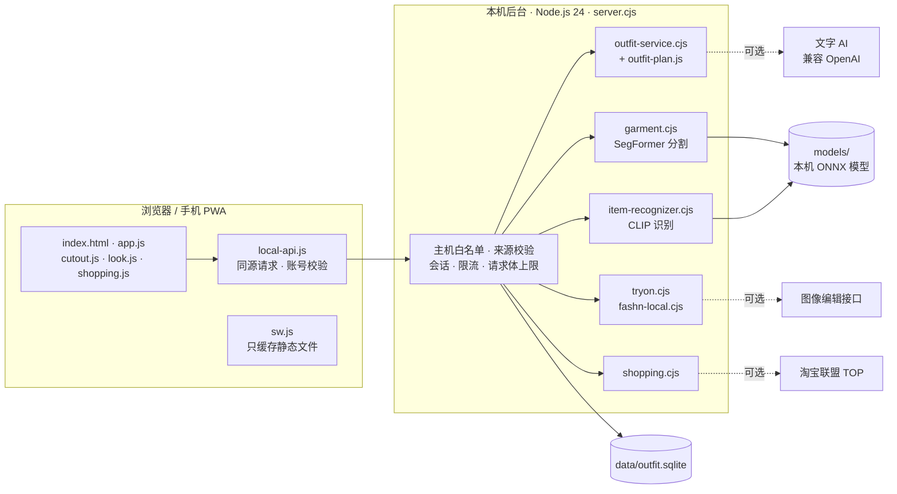

# 技术大纲 · Weave Fit

> 适用版本：完整 App 1.3.0（数据结构版本 1）。用户与开发流程见 [WORKFLOW.md](WORKFLOW.md)，安装与运行见 [README.md](README.md)。

## 1. 定位与设计原则

- **本机优先**：账号、衣橱、照片和模型推理都在用户自己的电脑上，仓库不包含任何真实数据。
- **单进程、无框架**：Node.js 内置 `http`、`node:sqlite`、`node:test` 和 `crypto`，运行依赖只有 `sharp` 与 `@huggingface/transformers`，前端为原生 HTML / CSS / JS，无构建步骤。
- **可选增强、可降级**：文字 AI、图像服务、本机 FASHN 和淘宝联盟都通过 `.env` 开启；未配置或调用失败时退回本地规则或淘宝搜索链接，基本功能不受影响。
- **一份规则多处复用**：`outfit-plan.js` 同时运行在后台、App 前端和项目主页。
- **默认安全**：同源请求、HttpOnly 会话、主机白名单、按账号隔离、限流和请求体上限。

## 2. 总体架构



- 同一个 Node 进程既提供 `public/` 静态文件，也提供 `/api/*` 接口，浏览器只与本机后台通信。
- 外部服务都由后台调用，密钥不进入浏览器；虚线表示只有配置后才会使用。
- 项目主页是另一条独立的静态链路：`index.html` + `homepage/` + App 的公开脚本，发布到 GitHub Pages，不连接后台（见第 10 节）。

## 3. 技术栈

| 层 | 选型 | 说明 |
| --- | --- | --- |
| 运行时 | Node.js ≥ 24 | 内置 `http`、`node:sqlite`、`node:test`、`crypto.scrypt` |
| 存储 | SQLite（`node:sqlite`，WAL 模式） | 单文件 `data/outfit.sqlite`，照片以 BLOB 存在 `files` 表 |
| 图像处理 | sharp ~0.34.5 | 图片解码校验，合成 1080×1080 白底单品图 |
| 本机推理 | @huggingface/transformers ^3.8.1 | ONNX 量化模型（q8，CPU，只读本地文件） |
| 前端 | 原生 HTML / CSS / JS | PWA：`manifest.webmanifest` + Service Worker |
| 测试 | node:test + jsdom 31.0.1 | 接口、规则、界面流程、Service Worker |
| 可选服务 | 兼容 OpenAI 的对话接口、Images Edit 接口、FASHN VTON（Python）、淘宝联盟 TOP | 均在 `.env` 配置 |

## 4. 目录与模块

### 4.1 后台（`outfit-independent/`）

| 文件 | 职责 |
| --- | --- |
| `server.cjs` | HTTP 服务：路由与方法表、安全检查、会话、限流，以及 records / files / backup / import |
| `launch.cjs` | 启动器：显示本机与局域网地址，写入 `data/logs/server.log`，当天没有备份时先备份 |
| `validation.cjs` | 记录字段校验、衣物类别、搭配请求参数 |
| `outfit-service.cjs` | 看天穿衣 `generate` 与自选搭配 `manual`；可选文字 AI 及其本地校验 |
| `garment.cjs` | SegFormer 衣物分割，输出居中的 1080×1080 白底 PNG |
| `item-recognizer.cjs` | CLIP 零样本识别名称、类别、主色、季节 |
| `tryon.cjs` | 本人全身穿搭图：远程 Images Edit 接口或本机 FASHN |
| `fashn-local.cjs` | 检测本机 FASHN 环境并调用 `scripts/fashn-inference.py` |
| `shopping.cjs` | 淘宝联盟物料搜索（请求签名、结果过滤） |
| `provider-json.cjs` | 读取并解析外部服务返回的 JSON |
| `public-launch.cjs` | 公网测试入口（默认停用） |

### 4.2 App 前端（`outfit-independent/public/`）

| 文件 | 职责 |
| --- | --- |
| `index.html` · `styles.css` · `app.js` | App 外壳与主要界面：衣橱、搭配、收藏、档案、补购、试穿、备份 |
| `local-api.js` | 同源请求客户端：每个私有请求带 `x-outfit-owner`；其他标签页切换账号时中止旧请求 |
| `cutout.js` | 读取照片（按 EXIF 方向）与压缩，调用 `/api/garment` 和 `/api/wardrobe/analyze` |
| `outfit-plan.js` | 搭配规则引擎（第 9 节） |
| `style-guide.js` | 风格指南「复古学院 · 甜酷日常」，整理自 17 张用户提供的搭配拼贴 |
| `look-reference.js` | 单品颜色、轮廓示意、搭配板与海报 SVG；待补单品一律用程序绘制的款式轮廓，不使用照片 |
| `look.js` | 导出搭配参考图（嵌入本人照片） |
| `shopping.js` | 补购：淘宝搜索链接与商品卡 |
| `taobao-connect.html` · `taobao-connect.js` | 淘宝联盟应用连接页 |
| `pwa.js` · `sw.js` · `manifest.webmanifest` | 安装与离线静态缓存 |
| 图片 | 图标，四季风格图 `style-source-*.jpg` |

### 4.3 项目主页（仓库根目录）

| 文件 | 职责 |
| --- | --- |
| `index.html` | 页面结构与文案：首屏、数字、痛点、四个功能演示、三步开始、隐私、常见问题、下载与启动、页脚署名 |
| `homepage/home.css` | 设计变量、手机样机、功能演示、响应式与「减少动态效果」 |
| `homepage/home.js` | 示例衣橱数据（18 张 Unsplash 照片）、首屏天气轮播、拍照入橱演示、看天穿衣、自己滑着搭、衣橱筛选、照片署名 |
| `homepage/photos/` | 示例衣橱照片：18 张 480×480 缩略图 `item-编号.jpg`、5 张 960px 宽的拍照入橱用图 `scan-编号.jpg`，以及本机模型生成的白底单品图 `cutout-编号.jpg`（600×600，JPEG） |
| `scripts/build-pages.cjs` | 把主页及依赖同步到 `docs/`（先清空 `docs/homepage/` 与 `docs/outfit-independent/`） |

## 5. 数据模型

表结构（`server.cjs` 启动时创建）：

```sql
CREATE TABLE users(id TEXT PRIMARY KEY, username TEXT UNIQUE NOT NULL, salt TEXT NOT NULL, password_hash TEXT NOT NULL);
CREATE TABLE sessions(token_hash TEXT PRIMARY KEY, owner TEXT NOT NULL REFERENCES users(id), expires INTEGER NOT NULL);
CREATE TABLE records(id INTEGER PRIMARY KEY AUTOINCREMENT, owner TEXT NOT NULL REFERENCES users(id), collection TEXT NOT NULL, payload TEXT NOT NULL, created_at TEXT NOT NULL);
CREATE INDEX records_owner ON records(owner, collection);
CREATE TABLE files(path TEXT PRIMARY KEY, owner TEXT NOT NULL REFERENCES users(id), content_type TEXT NOT NULL, data BLOB NOT NULL);
CREATE TABLE imports(owner TEXT NOT NULL, digest TEXT NOT NULL, PRIMARY KEY(owner, digest));
```

业务数据以 JSON 存在 `records.payload`，按 `collection` 区分：

| collection | 内容 | 图片字段 | 约束 |
| --- | --- | --- | --- |
| `profiles` | 个人档案与身材资料 | `face_photo_path`、`full_body_photo_path` | 每个账号最多 1 条 |
| `wardrobe_items` | 衣橱单品：名称、类别、颜色、季节等 | `image_path`（白底图）、`original_path`（原图） | 类别：上装、外套、下装、连衣裙、鞋履、包袋、配饰、其他 |
| `outfits` | 收藏的搭配方案 | 嵌套的 `image_path`、`original_path`、`tryonImage`、`lookImage` 等 | 引用的图片必须属于本账号 |

- `files.path` 必须以 `users/<账号ID>/` 开头，长度不超过 350，不含 `..`、反斜杠或空字符；同一路径不可覆盖。
- 仍被档案、衣橱或收藏引用的图片拒绝删除（409）。
- `imports.digest` 是备份内容的 SHA-256，用于阻止同一份备份重复导入。

完整备份格式（`GET /api/backup`）：

```json
{
  "format": "outfit-mirror-backup",
  "version": 1,
  "exported_at": "2026-01-01T00:00:00.000Z",
  "tables": { "profiles": [], "wardrobe_items": [], "outfits": [] },
  "files": [{ "path": "users/<账号ID>/…", "type": "image/png", "base64": "…" }]
}
```

## 6. 接口清单

约定：

- 全部为同源接口；JSON 请求必须带 `Content-Type: application/json`（否则 415）。成功返回 `{"data": …}`，失败返回 `{"error": {"message": "…"}}` 和对应状态码，500 错误不暴露内部信息。
- 请求方式不在方法表内时返回 405 并带 `Allow` 头；`/api/` 下除健康检查与登录相关接口外都要求登录（否则 401）。
- 请求带 `x-outfit-owner` 且与当前会话不一致时返回 409，并带 `X-Outfit-Account-Mismatch: 1`。

| 接口 | 方法 | 登录 | 限流 | 请求体上限 | 用途 |
| --- | --- | --- | --- | --- | --- |
| `/api/health` | GET | 否 | — | — | 健康检查 |
| `/api/auth/register` | POST | 否 | 与登录合计 20 次 / 10 分钟 / IP | 16 KB | 注册并直接登录 |
| `/api/auth/login` | POST | 否 | 同上 | 16 KB | 登录，签发 7 天会话 |
| `/api/auth/logout` | POST | 否 | — | — | 删除当前会话 |
| `/api/auth/session` | GET | 否 | — | — | 当前登录账号（未登录为 null） |
| `/api/auth/password` | POST | 是 | 5 次 / 10 分钟 | 16 KB | 修改密码，该账号全部会话失效 |
| `/api/status` | GET | 是 | — | — | 版本、存储、规则、模型与可选服务状态 |
| `/api/records` | POST | 是 | — | 1 MB | 按 `mode` 读写三类记录 |
| `/api/files?path=` | GET · HEAD · PUT · DELETE | 是 | — | PUT 8 MB | 私有图片读写 |
| `/api/garment?category=` | POST | 是 | 12 次 / 分钟 | 8 MB | 衣物分割，返回白底 PNG |
| `/api/wardrobe/analyze?category=` | POST | 是 | 12 次 / 分钟 | 8 MB | 名称、类别、主色、季节建议 |
| `/api/outfits/generate` | POST | 是 | 12 次 / 分钟 | 16 KB | 看天穿衣方案 |
| `/api/outfits/manual` | POST | 是 | 30 次 / 分钟 | 16 KB | 校验三件自选单品并给出提醒 |
| `/api/shopping/status` | GET | 是 | — | — | 淘宝联盟是否已配置 |
| `/api/shopping/search` | POST | 是 | 30 次 / 分钟 | 2 KB | 每件待补单品最多 3 个商品候选 |
| `/api/tryon/status` | GET | 是 | — | — | 试穿是否可用、本机或远程、模型 |
| `/api/tryon` | POST | 是 | 3 次 / 10 分钟，同时 1 个 | 128 KB | 生成本人全身穿搭图 |
| `/api/models` | GET | 是 | — | — | 已配置的文字模型 |
| `/api/chat` | POST | 是 | 6 次 / 分钟 | 128 KB | 文字 AI 代理：最多 10 条消息，45 秒超时 |
| `/api/backup` | GET | 是 | — | — | 下载完整 JSON 备份 |
| `/api/import` | POST | 是 | — | 64 MB | 把备份导入空账号 |

`/api/records` 请求体：

```json
{ "table": "wardrobe_items", "mode": "select", "id": 12, "row": {}, "limit": 100, "single": false }
```

`table` 为三类 collection 之一，`mode` 为 `select`、`insert`、`update` 或 `delete`；`limit` 取 1–1000，`update` 与 `delete` 必须给出 `id`。

## 7. 安全设计

| 方面 | 做法 |
| --- | --- |
| 主机白名单 | 只接受 `localhost`、`127.0.0.1`、`[::1]`、本机网卡地址与 `APP_HOSTS` 中的域名，防止 DNS 重绑定 |
| 跨站请求 | 写请求的 `Origin` 必须与 `Host` 一致，`Sec-Fetch-Site` 不能是 `cross-site`；会话 Cookie 为 `SameSite=Strict` |
| 会话 | 32 字节随机令牌，数据库只存其 SHA-256；Cookie `outfit_session` 为 HttpOnly、Path=/、7 天有效，`COOKIE_SECURE=1` 时加 Secure |
| 密码 | scrypt（16 字节随机盐，64 字节派生），恒定时间比较；账号不存在时同样计算哈希，避免通过耗时判断账号；密码 10–200 位，账号 3–80 位并统一小写 |
| 修改密码 | 校验当前密码、新旧不同，在事务内更新并删除该账号全部会话 |
| 账号隔离 | 每次查询都带 `owner` 条件；图片路径必须位于本账号目录；记录引用的图片必须存在且属于本账号 |
| 输入限制 | 每个接口单独设置请求体上限；图片先校验文件头再用 sharp 解码（最多 2500 万像素）；备份每类记录与图片各不超过 1000 条，每张图片不超过 8MB |
| 限流 | 内存固定窗口：登录 / 注册按客户端 IP，其余按账号；试穿每个账号同时只运行一个任务，本机一次只处理一张照片 |
| 响应头 | `X-Content-Type-Options: nosniff`、`Referrer-Policy: same-origin`、`X-Frame-Options: DENY`、`Cache-Control: no-store`；`PUBLIC_HTTPS_ONLY=1` 时加 HSTS 并把 HTTP 重定向到 HTTPS |
| 外部服务 | 密钥只在后台；文字 AI 与图像服务地址必须是 HTTPS（本机地址除外）且不含凭证；禁止重定向，并设置超时（文字 45 秒，图像 180 秒） |
| 隐私 | 远程试穿前必须得到用户明确同意；淘宝查询只发送单品关键词；Service Worker 不缓存任何接口数据 |
| 反向代理 | 只有 `TRUST_LOOPBACK_PROXY=1` 且连接来自本机时，登录限流才采用 `X-Forwarded-For` 的最后一跳 |

## 8. 本机模型

| 用途 | 模型 | 运行方式 | 安装 |
| --- | --- | --- | --- |
| 衣物分割 | `Xenova/segformer_b2_clothes`，固定版本 `cb6ac44e641faa309f29561c1afe08d87ef52631` | image-segmentation，q8，CPU，只读本地文件 | `node scripts/setup-garment-model.cjs` |
| 单品识别 | `Xenova/clip-vit-base-patch32` | zero-shot-image-classification，q8，CPU，只读本地文件 | `node scripts/setup-item-recognizer.cjs` |

- 模型保存在 `outfit-independent/models/`，已被 `.gitignore` 排除；推理全部在本机，不向模型网站发送照片。
- 分割流程：按所选类别取衣物掩码 → 连通域清理，去掉小碎片 → 裁切后居中合成到 1080×1080 白底（sharp）。
- 识别使用衣物区域而非杂乱背景的像素；分割失败时仍返回可编辑的元数据，并保留原图。
- `GET /api/status` 与 `npm run diagnose` 都会报告模型是否就绪。

## 9. 搭配规则引擎

`public/outfit-plan.js` 是 UMD 模块：浏览器中为 `window.OutfitPlanner`，Node 中通过 `require` 使用；它依赖 `style-guide.js`（`OutfitStyleGuide`）。

| 函数 | 作用 |
| --- | --- |
| `climateFor(o)` | 由季节、温度、天气得到温度档位、建议、是否雨雪 / 大风、是否需要外套 |
| `suggest(wardrobe, picked, request)` | 从衣橱挑选完整搭配，并列出缺少的单品、提示与提醒 |
| `unsuitable(item, climate)` | 判断单品是否不适合当前温度 |
| `validate(plan, wardrobe, request)` | 检查方案与温度、类别是否匹配，返回问题列表 |
| `group(item)` · `styleMatch(item, style)` · `currentSeason()` · `prefersVacationDress(climate, request)` | 分组、风格匹配、当前季节、度假场合偏好 |
| `seasonDefaults` | 季节默认温度：春季 18°C、夏季 30°C、秋季 18°C、冬季 5°C |

温度档位（温度先限制在 −10…40°C；未给温度时用季节默认值，季节也没有时按 22°C）：

| 档位 | 温度 | 名称 |
| --- | --- | --- |
| 0 | ≤ 5°C | 寒冷保暖 |
| 1 | ≤ 11°C | 偏冷叠穿 |
| 2 | ≤ 17°C | 凉爽外搭 |
| 3 | ≤ 23°C | 温和轻装 |
| 4 | ≤ 28°C | 偏热透气 |
| 5 | > 28°C | 炎热清凉 |

- 天气含「雨 / 雪」时标记为雨雪天气（自选搭配会提醒雨具与鞋底防滑），含「风」时影响是否需要外套；档位 0–2 默认需要外套。
- 文字 AI 方案必须同时满足以下条件，否则回退为规则方案：通过 `validate()`；度假场合包含合适的连衣裙；保留用户预选且适温的单品。
- 规则只在这一个文件维护，后台、App 和主页共用，改动后运行 `npm test`（`outfit-plan.test.cjs`、`outfit-service.test.cjs`）。

## 10. 项目主页

脚本按依赖顺序加载：`style-guide.js` → `outfit-plan.js` → `homepage/home.js`。版式参考同类数字衣橱产品的官网（调研见 [WORK.md](WORK.md)）：一句话主张与手机样机 → 数字 → 痛点 → 四个可操作的功能演示 → 三步开始 → 隐私 → 常见问题 → 下载与启动。

| 区块 | 实现 |
| --- | --- |
| 首屏「今日搭配」 | 4 组天气预设（20° 多云、14° 小雨、30° 晴、4° 大风）分别调用 `OutfitPlanner.suggest`；`variant` 相当于在 App 里点了几次「换一套」，让四组尽量展示不同单品。搭配板取 4 格：有连衣裙时为外套、连衣裙、鞋、包，否则为外套、上装、下装、鞋、包中实际选到的前 4 件。每 4.6 秒切换一组，指针停在样机上、首屏离开视口或页面隐藏时暂停，点预设按钮后停止自动轮播；开启「减少动态效果」时不自动轮播 |
| 01 拍照入橱 | 示例照片轮换，数据在 `home.js` 的 `scanData`：衣物区域 `box`、名称、类别、主色、季节都来自 App 本机 SegFormer + CLIP 对 `scan-编号.jpg` 的真实输出（用 `scripts/export-scan-demo.cjs` 离线导出，页面不在浏览器里推理）。照片以 `object-fit: cover` 铺满 4:5 画面，`scanBox()` 把 `box`（原图宽高的百分比）换算成画面坐标；框线从整幅收拢到衣物处，依次填出四个字段，最后在右下角淡入真实生成的白底单品图 `cutout-编号.jpg`。「换一张」只在 `scanData` 里有数据的照片间轮换 |
| 02 看天穿衣 | 季节（套用 `seasonDefaults` 的示例温度）、实际温度（−10…40°C）、天气、风格、场合 → `OutfitPlanner.suggest`，与 App 同一套规则；缺少的单品显示衣架占位和「建议添置」，提醒列出 `warnings`、待补建议与 `tips`。「换一套」递增 `variant`，「拿去自己调整」把方案放进下一块 |
| 03 自己滑着搭 | 「上装 / 外套」「下装」「鞋子」三行，支持滑动、按钮、方向键与 Home / End、随机和重置；按看天穿衣当前的温度用 `unsuitable()` 检查，只提醒不替换；需要外搭时只推荐示例衣橱里此刻适温的外套 |
| 04 数字衣橱 | 按类别筛选 18 件示例单品，点一件放进「自己滑着搭」；包袋不在三行里，点选时提示由规则搭配自动配上 |
| 页脚署名 | 由 `closet` 生成 18 条署名：单品名链接到 Unsplash 原图页，并注明摄影师 |

示例照片与数据：

- `closet` 中每件单品有 `photo`（Unsplash 图片编号）、`page`（原图页面）、`by`（摄影师），可选 `rect`（原图像素裁切区域，避开同框的其他衣服）；`photo` 与 `rect` 记录本地照片的来源，重新下载时使用。拍照入橱用到的照片另有 `scanData` 条目（`box`、`size`、识别字段）。
- 照片随主页发布在 `homepage/photos/`，`photoUrl()` 按单品编号拼出本地路径：`item-编号.jpg` 是 480×480 的正方形缩略图（按 `rect` 裁切后缩放），首屏、列表、三行滑动和衣橱共用一张；`scan-编号.jpg` 是 960px 宽的整张图，宽高比与原图一致，`box` 的百分比因此仍然适用。两种图都由 Unsplash 图床按 `photo`、`rect` 生成后下载（JPEG，质量 72）。首屏图片立即加载，其余 `loading="lazy"`；首屏其余三组和拍照入橱的其余照片会预先加载，切换时不出现空白。
- 照片来自 Unsplash 免费图库（Unsplash License），只作演示，页面与页脚都注明不是在售商品，也不是任何用户的衣橱。

主页只读取静态文件，不调用后台，不读取或保存任何个人数据；支持 375px 手机宽度与 `prefers-reduced-motion`（`animate()` 在减少动态效果时不执行，CSS 关闭过渡）。

## 11. PWA 与缓存

- `sw.js` 只处理同源 GET，并且只处理 `STATIC` 白名单中的静态路径：网络优先，离线时回退缓存。
- 登录、记录、图片、备份和生成结果等接口一律直连网络，从不缓存（`worker.test.cjs` 覆盖）。
- 缓存名当前为 `outfit-mirror-independent-v26`；新版本激活时只删除本应用的旧缓存。

## 12. 测试

| 文件 | 主要内容 |
| --- | --- |
| `account-owner.test.cjs` | 账号请求头阻止过期的读、写和退出；私有图片不能跨账号引用 |
| `backend.test.cjs` | 持久化、登录、私有照片、备份与迁移 |
| `backend-validation.test.cjs` | 非法输入返回明确的 400；图片必须可解码；删除衣物后仍被引用的照片保留 |
| `garment.test.cjs` | 浅色衣物保留、人物与背景去除；缺少衣物类别时明确失败 |
| `item-auto-fill.test.cjs` | 上传后自动填写四个字段并尊重手动修改；识别接口校验账号与图片 |
| `item-recognizer.test.cjs` | 用衣物像素识别；分割失败时仍有元数据与原图 |
| `look-reference.test.cjs` | 明确颜色优先；搭配板包含全部单品；待补单品只用轮廓示意、不出现照片 |
| `manual-ui.test.cjs` | 三行可用按钮、键盘和触摸独立选择 |
| `operations.test.cjs` | 启动器端口与地址；在线备份包含 WAL 中已提交的数据且不覆盖源库 |
| `outfit-plan.test.cjs` | 度假优先连衣裙；30°C 不选普通卫衣，18°C 不选短袖上衣 |
| `outfit-service.test.cjs` | 只使用当前账号衣橱；AI 结果校验，服务失败或虚构单品时回退 |
| `public-access.test.cjs` | 公网入口强制 HTTPS、安全 Cookie、同源操作与登录限流 |
| `shopping.test.cjs` · `shopping-ui.test.cjs` | TOP 签名、不发送个人字段、安全处理上游失败；未配置时提供搜索链接 |
| `tryon.test.cjs` | 使用本人资料与衣物、必须同意；校验温度、类别与层次 |
| `worker.test.cjs` | Service Worker 不拦截私有数据，只清理本应用旧缓存 |
| `ui-check.cjs` · `account-switch-check.cjs` | jsdom 界面流程；多标签页账号切换 |

`npm test` 运行全部 `*.test.cjs`；`npm run test:all` 依次运行上述全部检查，并清空外部服务密钥，保证测试不调用真实服务。

## 13. 运维脚本

| 脚本 | 用途 |
| --- | --- |
| `scripts/run-checks.cjs` | `npm run test:all`：完整检查 |
| `scripts/diagnose.cjs` | `npm run diagnose`：Node 版本、依赖和本机模型 |
| `scripts/backup-database.cjs` | `npm run backup`：在线备份数据库到 `data/backups/` |
| `scripts/reset-local-password.cjs` | `npm run recover-account`：本机重设密码，先备份并让该账号在所有设备退出 |
| `scripts/setup-garment-model.cjs` | 下载固定版本的衣物分割模型 |
| `scripts/setup-item-recognizer.cjs` | 下载单品识别模型 |
| `scripts/prepare-import.cjs` | `node scripts/prepare-import.cjs <导出目录> <输出.json>`：把旧网站的单用户导出（`profiles.json`、`wardrobe_items.json`、`outfits.json`、`images/`）转换为备份格式 |
| `scripts/export-scan-demo.cjs` | `node scripts/export-scan-demo.cjs 7:外套 16:包袋`：用本机模型处理主页 `scan-编号.jpg`，输出 `scanData` 条目并写入 `cutout-编号.jpg`（需先下载两个模型） |
| `scripts/fashn-inference.py` | 本机 FASHN VTON 推理，由 `fashn-local.cjs` 调用 |
| `scripts/preview-test.cjs` | 启动隔离的浏览器检查实例，不打开或复制用户数据库 |
| `scripts/public-host.cjs` · `public-bridge.cjs` · `stop-public.cjs` | 公网测试入口（默认停用） |

## 14. 配置项

配置写在 `outfit-independent/.env`（参考 `.env.example`），由 `npm start` 读取。

| 变量 | 作用 | 默认 |
| --- | --- | --- |
| `HOST` · `PORT` | 监听地址与端口 | `127.0.0.1` · `8090`；启动器默认允许同一 Wi-Fi 访问 |
| `LLM_API_BASE` · `LLM_API_KEY` · `LLM_MODEL` | 文字 AI（`/chat/completions`），三项齐全才启用 | 未配置 |
| `IMAGE_API_KEY` · `IMAGE_API_URL` · `IMAGE_MODEL` | 远程试穿图像接口 | 地址默认 OpenAI Images Edit，模型默认 `gpt-image-2`；密钥可回退到 `OPENAI_API_KEY` |
| `FASHN_PYTHON` · `FASHN_WEIGHTS` | 本机 FASHN VTON：Python 可执行文件存在且权重目录含 `model.safetensors` 时启用，一次处理一张 | 未配置 |
| `TAOBAO_APP_KEY` · `TAOBAO_APP_SECRET` · `TAOBAO_ADZONE_ID` | 淘宝联盟商品卡（推广位 ID 为数字） | 未配置 |
| `APP_HOSTS` | 额外允许访问的域名，逗号分隔 | 空 |
| `COOKIE_SECURE` | 设为 `1` 时会话 Cookie 加 Secure（HTTPS 部署时开启） | 关闭 |
| `PUBLIC_HTTPS_ONLY` · `TRUST_LOOPBACK_PROXY` | 由公网入口脚本设置：强制 HTTPS；信任本机反向代理转发的客户端地址 | 关闭 |

## 15. 部署形态

| 形态 | 做法 | 适用 |
| --- | --- | --- |
| 本机 + 局域网 | `node launch.cjs`，同一 Wi-Fi 的手机用局域网地址访问 | 个人日常使用（默认） |
| 自有域名 | HTTPS 反向代理到本机端口，设置 `APP_HOSTS=<域名>` 与 `COOKIE_SECURE=1`，持久化 `data/` 并定期备份 | 需要外网访问时 |
| 项目主页 | `node scripts/build-pages.cjs` 后由 GitHub Pages 发布 `main` 分支的 `/docs` | 展示与演示 |

完整 App 需要持久的 SQLite 与本机模型，不能部署到 GitHub Pages 这类纯静态托管。

## 16. 已知限制

- 单进程设计：限流计数、试穿任务锁和照片处理锁都在内存中，重启后清零，多个实例之间不共享。
- 照片以 BLOB 存在 SQLite，数据库随照片增长；备份为 base64 JSON，单次导入上限 64MB。
- 没有邮箱验证与找回，忘记密码只能在本机终端重设。
- 识别为零样本分类，季节只按可见款式估计；复杂背景或多件叠放时分割可能不准确。
- 规则引擎为启发式，搭配结果取决于衣橱里实际有哪些单品。
- 项目主页拍照入橱演示是离线导出的模型结果，页面里不现场推理；个别结果会不准（例如纱质半身裙的抠图边缘有缺口、名称被识别成「棕黑配色」），演示保留原样，不做修饰。
- 仓库暂无许可证文件。

## 17. 路线图

逐项待办、优先级与完成标准见 [WORK.md 第 5 节](WORK.md#5-待办)。

- **近期**：App 界面沿用主页的视觉语言；规则引擎细分通勤、约会、运动等场合，补充雨雪天鞋履约束。
- **中期**：穿着记录与统计（穿着日历、穿着次数）；分片备份与导入，突破 64MB；持续集成；补充许可证与贡献指南。
- **长期**：服务器版部署方案（HTTPS、持久存储、多实例共享限流）；更多本机模型（如材质识别），持续保持「照片不出本机」。
