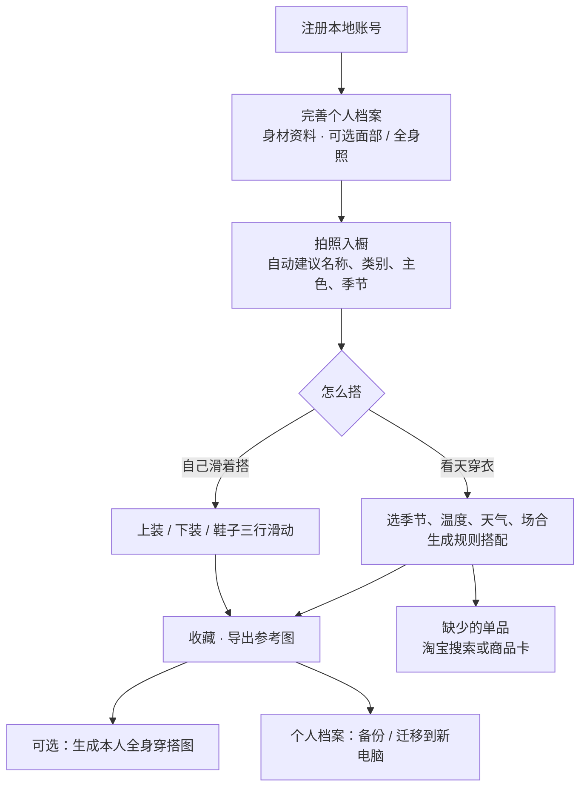
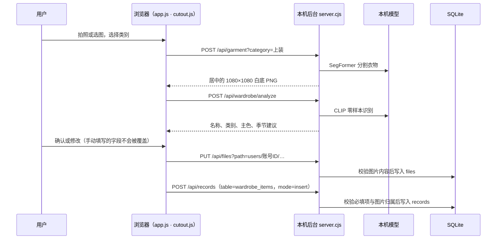
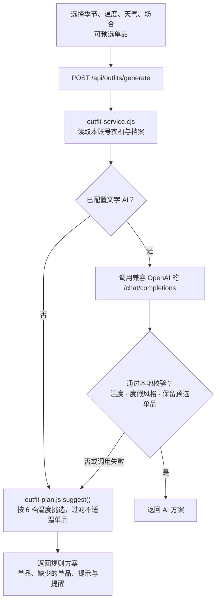
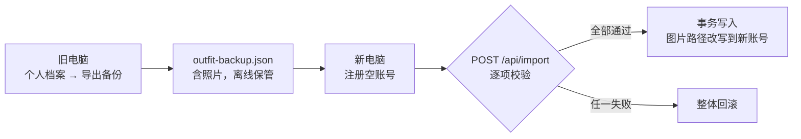
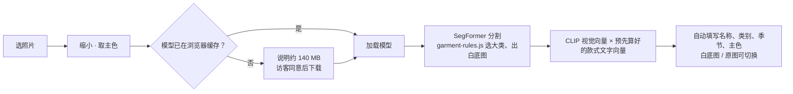

# 工作流程 · Weave Fit

本文说明三件事：用户怎样使用穿搭魔镜，每个核心功能在浏览器与本机后台之间怎样流转，开发者怎样修改、检查和发布。模块职责、数据表、接口参数与安全设计见 [TECHNICAL_OUTLINE.md](TECHNICAL_OUTLINE.md)；每轮迭代的依据、改动、验证结果和待办记在 [WORK.md](WORK.md)。

## 1. 用户旅程



| 阶段 | 用户做什么 | 需要外部服务 |
| --- | --- | --- |
| 注册与档案 | 注册本地账号（密码至少 10 位），填写身材资料，可选上传面部 / 全身照 | 否 |
| 拍照入橱 | 拍照或选图，确认自动建议后保存 | 否（需先下载两个本机模型） |
| 看天穿衣 | 选择季节、温度、天气和场合，可预选想穿的单品 | 否；配置文字 AI 后由 AI 出方案，并经本地规则校验 |
| 自己滑着搭 | 三行分别左右滑动，组合后查看温度提醒 | 否 |
| 收藏与参考图 | 收藏整套方案，导出含本人照片的参考图 | 否 |
| 补购 | 对缺少的单品打开淘宝搜索，或查看真实商品卡 | 搜索链接不需要；商品卡需淘宝联盟应用 |
| 本人穿搭图 | 确认授权后生成全身穿搭图 | 需图像服务或本机 FASHN |
| 备份迁移 | 导出 JSON 备份，在新电脑导入空账号 | 否 |

## 2. 核心业务流程

### 2.1 拍照入橱



- 图片先上传、记录后写入：服务端会拒绝引用不存在或不属于当前账号的图片。
- 本机同一时间只处理一张照片；忙时返回 429 并带 `Retry-After`，`cutout.js` 会自动重试识别。
- 两个模型需先用 `setup-*` 脚本下载；登录后 `GET /api/status` 会报告模型是否就绪。识别只在本机进行，季节仅按可见款式估计。

### 2.2 看天穿衣（规则搭配）



- AI 方案不合规时自动回退为规则方案，并在提醒中说明，用户总能拿到可用结果。
- 温度档位、季节默认温度等规则见 [TECHNICAL_OUTLINE.md 第 9 节](TECHNICAL_OUTLINE.md#9-搭配规则引擎)。

### 2.3 自己滑着搭

1. 三行分别来自「上装 / 外套」「下装」「鞋履」，左右滑动只更换对应一行。
2. 选定后调用 `POST /api/outfits/manual`，`itemIds` 必须按上装、下装、鞋子的顺序给出三件本账号单品。
3. 服务端用同一套规则检查温度，只给提醒（不适温、外套需另配内搭、雨雪天防滑），不替换用户的选择。

### 2.4 收藏与参考图

- 收藏写入 `outfits` 表（`POST /api/records`），方案中引用的私有图片必须属于当前账号。
- 参考图与海报由 `look.js` 和 `look-reference.js` 生成：自有单品用本人照片，待补单品用参考图或轮廓示意。

### 2.5 补购

- 每件待补单品都有「去淘宝搜索这款」，按完整款式关键词打开淘宝搜索，不需要应用凭证。
- 配置淘宝联盟应用（`TAOBAO_APP_KEY`、`TAOBAO_APP_SECRET`、`TAOBAO_ADZONE_ID`）后，页面经 `POST /api/shopping/search` 调用 `taobao.tbk.dg.material.optional.upgrade`，每件最多展示 3 个候选。
- 查询只发送单品关键词，不发送照片、档案或衣橱图片；价格以接口返回的普通售价为准。

### 2.6 本人全身穿搭图

1. `GET /api/tryon/status` 返回是否可用、本机还是远程、服务商主机名和模型。
2. 使用远程图像服务前，用户必须确认同意发送面部照片、身材资料和衣服参考图；本机 FASHN 不需要外发。
3. `POST /api/tryon`：同一账号同时只运行一个任务，每 10 分钟最多 3 次。

### 2.7 备份、迁移与恢复



- 导入要求：支持的备份格式、账号为空、同一份备份未导入过、每张图片通过内容校验；大于 64MB 的备份需拆分。
- 旧网站数据可用 `scripts/prepare-import.cjs` 转为同一备份格式。
- 数据库级备份：`npm run backup`（写入 `data/backups/`）；启动器在当天还没有备份时会自动备份。
- 忘记密码：在这台电脑的交互终端运行 `npm run recover-account`，重设前自动备份，并让该账号在所有设备退出。

### 2.8 账号、会话与多标签页

- 登录后签发 7 天有效的 HttpOnly 会话；修改密码后该账号所有会话失效。
- 同一浏览器的另一个标签页切换账号时，`local-api.js` 会中止旧账号的请求；每个私有请求都带 `x-outfit-owner`，服务端发现账号不一致时返回 409，页面提示刷新。

### 2.9 网页版（仓库根目录，浏览器里的同一套流程）

网页版没有后台：账号、衣橱和识别都在访客自己的浏览器里，数据存在 IndexedDB `weave-fit-web`（`homepage/store.js`）。和完整 App 的对应关系：

| 环节 | 网页版怎么做 | 与 App 的关系 |
| --- | --- | --- |
| 注册 / 登录 | `register.html`、`login.html`；昵称 1–24 字、密码 10–200 位，PBKDF2-SHA256（21 万次、随机盐）只存哈希；勾选「记住我」时会话存在 localStorage，否则关闭浏览器即退出 | App 用 SQLite 账号与 HttpOnly 会话；两边账号互不相通 |
| 忘记密码 | 注册时显示一次找回码（12 位，只存哈希）；登录页「忘记密码？」用找回码设新密码并登录，用过的找回码作废、换发新的；登录后可在「个人档案 · 账号与安全」换一个找回码 | App 在本机终端运行 `npm run recover-account` |
| 访客试用 | 不登录也能用示例衣橱试遍看天穿衣、自己滑着搭和自动识别；保存单品、收藏、档案和备份需要账号 | — |
| 拍照入橱 | 选照片 → 缩小并取主色 → 首次征得同意后下载模型 → `recognize.js` 在浏览器里分割、抠白底图、识别款式 → 自动填写（手动改过的项不覆盖）→ 可改回原图 → 保存（白底图为主图，原图另存） | 同一份 `garment-rules.js`、同版本模型，识别结果与 App 一致 |
| 看天穿衣 / 自己滑着搭 | `outfit-plan.js` 在浏览器里运行；登录后默认用档案里排在最前的常穿风格 | 与 App 的本地规则相同；网页版没有文字 AI |
| 收藏与参考图 | 收藏只存单品编号和当时的名字；收藏和当前三行搭配都能画成 1080×1350 PNG 下载 | 对应 App 的收藏参考板 |
| 个人档案 | 性别、身高、体重、身形、肤色、发色、常穿风格、面部参考照片；在看天穿衣里显示成「我的参考」 | 字段与 App 一致；网页版没有本人试穿 |
| 备份 | 导出当前账号的单品（含白底图与原图）、收藏和档案（第 2 版 JSON）；导入到当前账号，逐项校验，编号与这台设备上别的账号冲突时换新编号，不覆盖别人的数据 | 格式与 App 的备份不同，两边不能互相导入 |
| 删除账号 | 需要当前密码，点两次确认，连同这个账号的单品、收藏和档案一起删除 | — |



## 3. 开发工作流

### 3.1 准备环境

```sh
cd outfit-independent
npm install                              # 含 devDependencies（测试需要 jsdom）
node scripts/setup-garment-model.cjs     # 可选：衣物分割模型
node scripts/setup-item-recognizer.cjs   # 可选：单品识别模型
npm start                                # 或 node launch.cjs（显示局域网地址）
```

需要可选服务时，把 `.env.example` 复制为 `.env` 后在本机填写；`.env` 已被 `.gitignore` 排除。

### 3.2 修改原则

每次改动遵循：先找已有实现 → 定位根因 → 选最小改动 → 复用已有模块 → 审查实际 diff → 运行相关检查 → 如实记录结果。本项目的具体约定：

| 内容 | 唯一维护位置 | 使用方 |
| --- | --- | --- |
| 温度 / 季节 / 场合规则 | `outfit-independent/public/outfit-plan.js` | 后台 `outfit-service.cjs`、App 前端、项目主页 |
| 风格词库与搭配风格 | `outfit-independent/public/style-guide.js` | 规则引擎、App、主页 |
| 单品颜色、轮廓示意、搭配板 | `outfit-independent/public/look-reference.js` | App（参考图、海报、待补单品） |
| 主页示例衣橱、照片来源与署名 | `homepage/home.js` 的 `closet` 数组 | 仅项目主页 |
| 记录字段校验与衣物类别 | `outfit-independent/validation.cjs` | 后台接口 |

- 不要在主页或其他文件复制一份规则；规则改动同时影响后台、App 和主页，改后运行 `npm test` 并打开主页确认。
- 新增接口：在 `server.cjs` 的方法表登记允许的请求方式，设置请求体上限和 `rate()` 限流（`/api/` 默认要求登录），并在 `test/` 补测试。
- `public/` 中的静态文件按扩展名白名单提供，新增文件后需重启服务；需要离线缓存的文件同时加入 `sw.js` 的 `STATIC` 列表。

### 3.3 运行与调试

| 手段 | 用途 |
| --- | --- |
| `npm run diagnose` | 检查 Node 版本、依赖和本机模型是否就绪 |
| `data/logs/server.log` | 启动器写入的后台日志（不会作为网页公开） |
| `GET /api/status`（登录后） | 版本、存储、规则、模型与可选服务的就绪状态 |
| `GET /api/health` | 不需要登录的健康检查 |

### 3.4 测试

| 命令 | 内容 |
| --- | --- |
| `npm test` | `node --test test/*.test.cjs`：接口、账号隔离、校验、规则、搭配服务、识别、补购、试穿、Service Worker 等 |
| `npm run test:all` | `scripts/run-checks.cjs`：上述测试 + `test/ui-check.cjs`（jsdom 界面流程）+ `test/account-switch-check.cjs`（多标签页账号切换） |

`run-checks.cjs` 会清空全部外部服务密钥再运行，测试不会调用真实的 AI、图像服务或淘宝接口，并使用独立的临时数据。

### 3.5 项目主页开发

1. 主页就是网页版，打开就能用：由 `index.html`、`login.html`、`register.html` 和 `homepage/` 下的 `home.css`、`home.js`、`store.js`、`account.js`、`recognize.js`、`clip-type-vectors.json` 组成，并加载 App 的 `style-guide.js`、`outfit-plan.js`、`garment-rules.js` 和 `icon.svg`；照片都在 `homepage/photos/`，除自动识别外预览不需要联网（Inter Tight 字体加载失败时回落到系统字体）。账号、衣服、收藏和档案存在浏览器 IndexedDB 的 `weave-fit-web` 数据库里，识别模型在 Cache Storage 的 `transformers-cache` 里，调试时可在开发者工具的「应用」面板查看或清空。
2. 在仓库根目录启动静态服务器预览：

   ```sh
   python -m http.server 8765
   ```

   打开 `http://127.0.0.1:8765/`。用静态服务器预览最接近 Pages 的实际环境；账号需要安全来源，必须用 `127.0.0.1` / `localhost` 或 HTTPS 打开，局域网 IP 的 http 地址会提示账号功能不可用。
3. 至少检查：桌面、768px 平板与 360px 手机宽度没有横向滚动；首屏随滚动换装、底部标题淡出、宣言区视差、风格卡展开与切换正常；注册（找回码只显示一次）、登录、密码错误、忘记密码、修改密码、换找回码、删除账号、退出都能使用；访客能试用示例衣橱，保存时提示登录；拍照入橱添加（自动识别、白底图 / 原图切换、不含照片）、修改、删除，刷新后数据仍在；看天穿衣的各项设定与「换一套」「收藏」「拿去自己调整」、三行滑动与随机、四个衣橱标签、搭配收藏、参考图、个人档案、导出与导入备份都能使用；系统开启「减少动态效果」时没有视差、模糊和位移；控制台没有报错，也没有内容安全策略（CSP）违规。
4. 示例单品只写在 `home.js` 的 `closet` 数组里；访客的数据只在访客自己的浏览器里，页面不向任何地址发送数据（自动识别只从固定的地址下载模型和推理库）。
5. 页面的内容安全策略写在三个 HTML 的 `<meta http-equiv="Content-Security-Policy">` 里：脚本只允许本站和 jsDelivr（识别库），不允许内联脚本和内联事件（字体样式表由脚本启用）。新增外部资源时先改这里，否则浏览器会拦截。
6. 识别规则改在 `outfit-independent/public/garment-rules.js`，App 与网页版同时生效；改了款式表（`types`）的英文描述或增删款式后，在 `outfit-independent/` 中运行 `node scripts/export-type-vectors.cjs`（需要本机 CLIP 模型）重新生成 `homepage/clip-type-vectors.json`。模型版本固定在 `recognize.js` 和 App 的 `setup-*` 脚本里，升级时两边一起改。
7. 网页版的照片：
   - 人物形象照 `look-*.webp`（首屏与风格卡）和登录 / 注册页背景 `auth-*.webp` 由用户提供，拼贴单品图 `piece-*.webp` 由 Figma AI 按提示词生成（透明背景，只裁掉四周空白、按显示尺寸的 2 倍缩小，不从人物照片里抠图）。这些都是 AI 生成的风格示意，页脚已注明；替换时保持同样的说明。
   - 示例衣橱的单品照片按下面的规则替换或新增。
8. 替换或新增示例衣橱照片：
   - 只用 Unsplash 免费图库的照片（Unsplash License）。不用 Unsplash+ 付费图、电商或品牌商品图、带明显品牌标识的图，也不用 AI 生成或程序绘制的衣服。
   - 优先选单件完整入镜、背景干净、光线自然的照片，整体保持中性色调，和现有单品放在一起要协调。
   - 在 `closet` 中填写 `photo`（地址里 `photo-` 后面的编号）、`page`（原图页面地址 `unsplash.com/photos/` 后面的部分）和 `by`（摄影师）；同框有其他衣服时用 `rect`（原图像素 x,y,宽,高）裁掉。名称、类别、颜色、季节按照片如实填写，季节取值与 App 单品表单一致。
   - 把照片下载到 `homepage/photos/`，文件名用两位单品编号。缩略图 `item-编号.jpg` 取 `https://images.unsplash.com/photo-<photo>?w=480&h=480&fit=crop&fm=jpg&q=72`，有 `rect` 时在 `?` 后加 `rect=<rect>&`。例如 `curl -fsSL -o homepage/photos/item-19.jpg "<地址>"`（Windows PowerShell 中写 `curl.exe`）。
   - 页脚署名由 `closet` 自动生成，不需要另外维护。

### 3.6 发布 GitHub Pages

```sh
node scripts/build-pages.cjs
git add index.html login.html register.html homepage docs
git commit -m "Update project homepage"
git push
```

- `build-pages.cjs` 会重建 `docs/homepage/` 和 `docs/outfit-independent/`，复制三个页面及其依赖的脚本、款式向量与照片，并写入 `.nojekyll`；`docs/` 中的其他文件保持不变。
- 仓库 Settings → Pages 选择 Deploy from a branch，分支 `main`，目录 `/docs`。
- 发布目录不包含 `data/`、`.env`、模型或任何个人照片。
- `homepage/photos/` 中的示例照片会一并复制到 `docs/homepage/photos/`，页面不依赖外部图床。

### 3.7 版本号与缓存

- App 版本记录在 `outfit-independent/package.json`，`GET /api/status` 返回的版本写在 `server.cjs`，发版时两处保持一致。
- `sw.js` 对静态文件采用网络优先、离线回退缓存。修改 `STATIC` 列表或希望清理旧缓存时，更新 `CACHE` 名称（当前为 `outfit-mirror-independent-v26`）；新版本激活时会删除旧缓存。

### 3.8 提交前检查清单

- [ ] `git status` 和 `git diff` 已逐项审查，没有混入无关改动
- [ ] 提交中没有 `data/`、`.env`、`*.sqlite`、`models/`、`node_modules/`、日志或个人照片
- [ ] 改动了后台或规则：`npm test` 通过；改动了界面：`npm run test:all` 通过
- [ ] 改动了主页或登录 / 注册页：已在浏览器检查桌面与手机宽度、控制台没有报错和 CSP 违规，并运行 `node scripts/build-pages.cjs`
- [ ] 改动了 `garment-rules.js`：`npm test` 通过；改了款式表时已重新生成 `clip-type-vectors.json`
- [ ] 改动了示例照片：来源是 Unsplash 免费图库，照片已存入 `homepage/photos/`，`page` 与 `by` 已填写，页脚署名正确
- [ ] 需要时已更新版本号与 `sw.js` 缓存名
- [ ] README、WORKFLOW、TECHNICAL_OUTLINE 中受影响的描述已同步；本轮改动、验证结果和遗留问题已记入 WORK.md

## 4. 数据与密钥规则

- 密钥只写在本机 `outfit-independent/.env`，由后台读取，不发送到浏览器，也不写入备份。
- 数据库、日志和备份都在 `data/`，已被 `.gitignore` 排除；推送时不要用 `git add -f` 强制添加。
- 完整备份 JSON 含本人照片，请离线保管，不要上传到仓库或公开网盘。
- 公网测试入口默认停用；如需用域名访问，先配置 HTTPS 反向代理、`APP_HOSTS` 和 `COOKIE_SECURE=1`，部署注意事项见 [outfit-independent/README.txt](outfit-independent/README.txt)。
